# Walkthrough: your first promotion from Dev to Test

This guide takes you from an empty Projects page to a finished promotion from
Dev to Test, one screen at a time. It is written for the Kinetic admin who
looks after the spaces. Allow about fifteen minutes the first time.

You can follow along without touching a real space: start the app in demo
mode with `npm run start:fake` (see [Get started](../README.md#get-started)).
Every screenshot here was taken in demo mode, so the names, addresses and
counts are synthetic: a Dev space at `https://dev.example.com` and a Test
space at `https://test.example.com`. Your own spaces will show your own kapps,
forms and workflows.

What you need for real spaces:

- the `https://` address of each space,
- the username and password of a **space admin** account in each (accounts
  that only sign in with single sign-on cannot be used),
- Kinetic Migrator running (`npm start`) with the browser open.

Contents:

1. [Create a project](#1-create-a-project)
2. [Connect Dev, the source](#2-connect-dev-the-source)
3. [Take the first snapshot](#3-take-the-first-snapshot)
4. [Add Test, the target](#4-add-test-the-target)
5. [Snapshot Test from Overview](#5-snapshot-test-from-overview)
6. [Explore what is in Dev](#6-explore-what-is-in-dev)
7. [Compare Dev with Test](#7-compare-dev-with-test)
8. [Look at an item's changes](#8-look-at-an-items-changes)
9. [Build a changeset](#9-build-a-changeset)
10. [Remove something only Test has](#10-remove-something-only-test-has)
11. [Save the changeset](#11-save-the-changeset)
12. [Review the plan](#12-review-the-plan)
13. [Environment values and secrets](#13-environment-values-and-secrets)
14. [Confirm](#14-confirm)
15. [Apply and watch it run](#15-apply-and-watch-it-run)
16. [Check History](#16-check-history)
17. [Preview a restore](#17-preview-a-restore)
18. [Saved changesets](#18-saved-changesets)
19. [Settings worth knowing](#19-settings-worth-knowing)
20. [Dark mode](#20-dark-mode)

## 1. Create a project

A project holds the environments of one Kinetic setup and everything you
promote between them.

**Do this:** on the Projects page choose **Create your first project** (later,
**New project**).

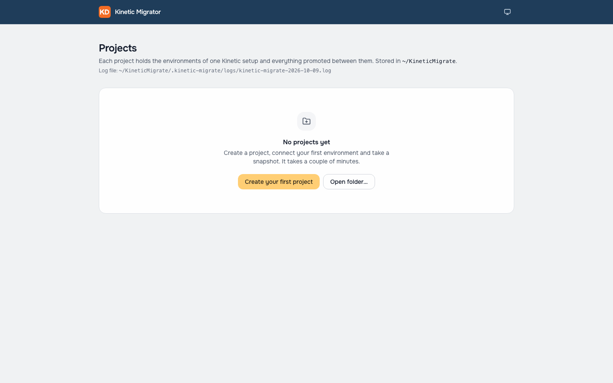

**Look for:** the line under the title says where projects are stored
(`~/KineticMigrate` by default) and where today's log file is.

**Do this:** type a **Project name**, such as `Service portal`, and choose
**Next**.

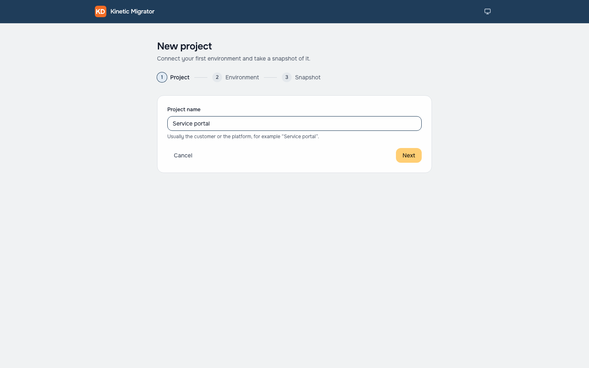

## 2. Connect Dev, the source

**Do this:**

1. Leave **Environment name** as `dev`.
2. Enter the **Space URL**, for example `https://dev.example.com`.
3. Turn on **Protected**.
4. Enter the **Username** and **Password** of a space admin.
5. Choose **Test connection**. When it says **Connected**, choose **Next**.

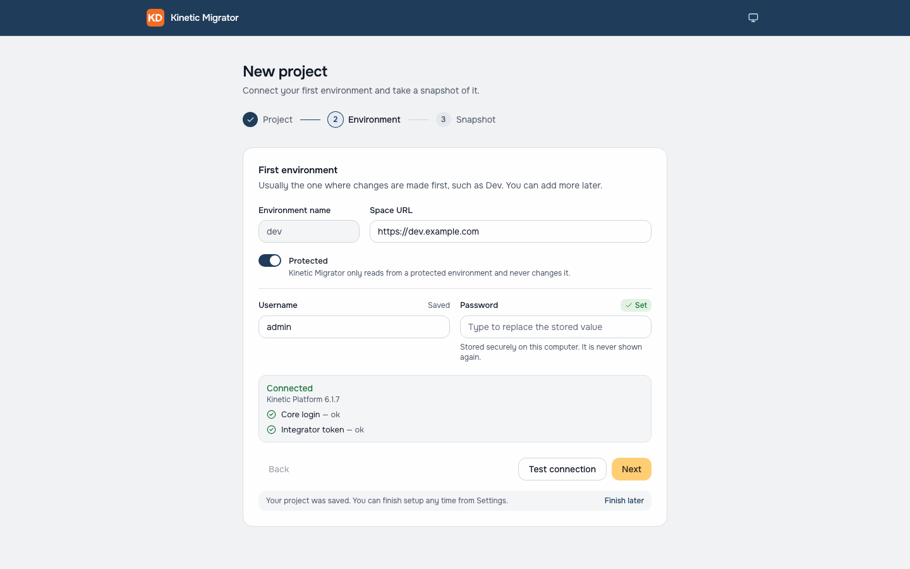

**Look for:** **Connected**, the Kinetic Platform version, and a tick next to
**Core login** and **Integrator token**. If Integrator fails, connections and
operations are left out of snapshots; see
[Troubleshooting](TROUBLESHOOTING.md#integrator-token-fails-or-connections-are-left-out).

> **Why it's safe.** A **Protected** environment is read-only: Kinetic
> Migrator talks to it with a client that can only send read requests, and
> refuses to apply anything to it. Protect every environment you only
> promote *from*. The password goes straight to your system keychain (macOS
> Keychain or Windows Credential Manager); it is never saved in the project
> and never shown again (the field shows **Set**).

## 3. Take the first snapshot

A snapshot reads every item in the environment (space settings, teams,
kapps, forms, workflows, connections, handlers, routines and more) so you can
explore and compare it. It only reads.

**Do this:** choose **Take snapshot**. Optionally enter **Your name** and
**Your email** so History shows who did what, then choose **Open overview**.

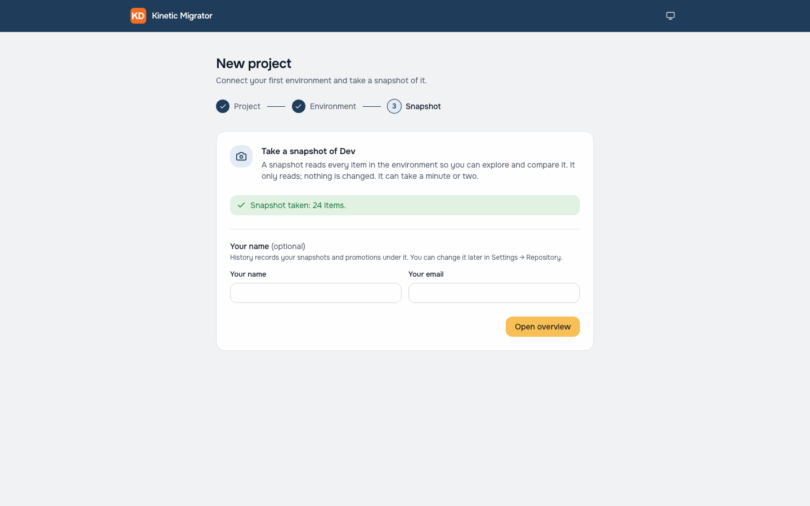

## 4. Add Test, the target

**Do this:** open **Settings** (top tabs), then **Environments**, and choose
**Add environment**. Enter `test`, its Space URL, a space admin's username
and password, and choose **Test connection**, then **Save**. Leave
**Protected** off: Test is where you will apply changes.

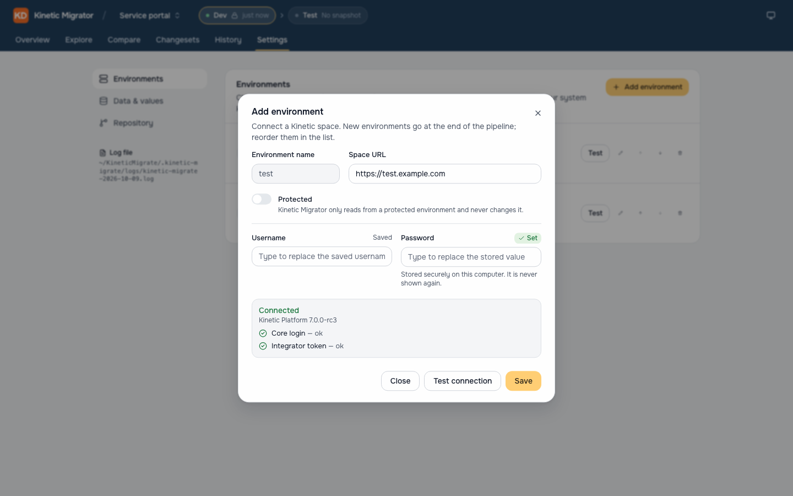

**Look for:** the environments in pipeline order. Changes move from the top
of the list to the bottom, so Dev comes before Test. Use the arrows to
reorder.

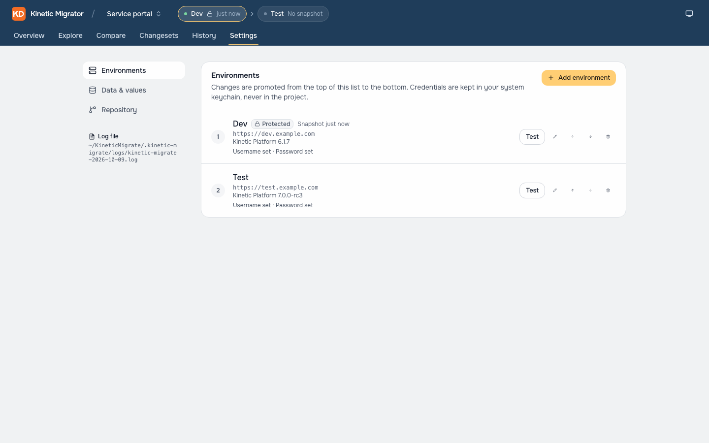

## 5. Snapshot Test from Overview

**Do this:** open **Overview**. Each environment has a lane; Test says **No
snapshot yet**. Choose **Take snapshot** on the Test lane.

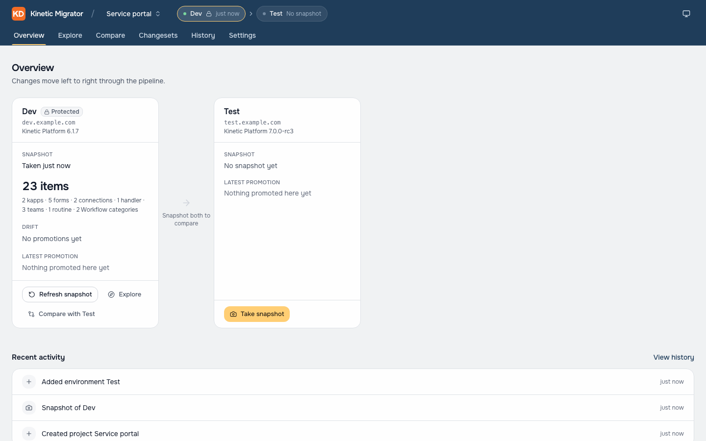

**Look for:** both lanes now show **Taken just now**, the item counts, and
**Compare with Test** on the Dev lane. **Drift** shows whether anything
promoted to an environment has since been changed there by hand.

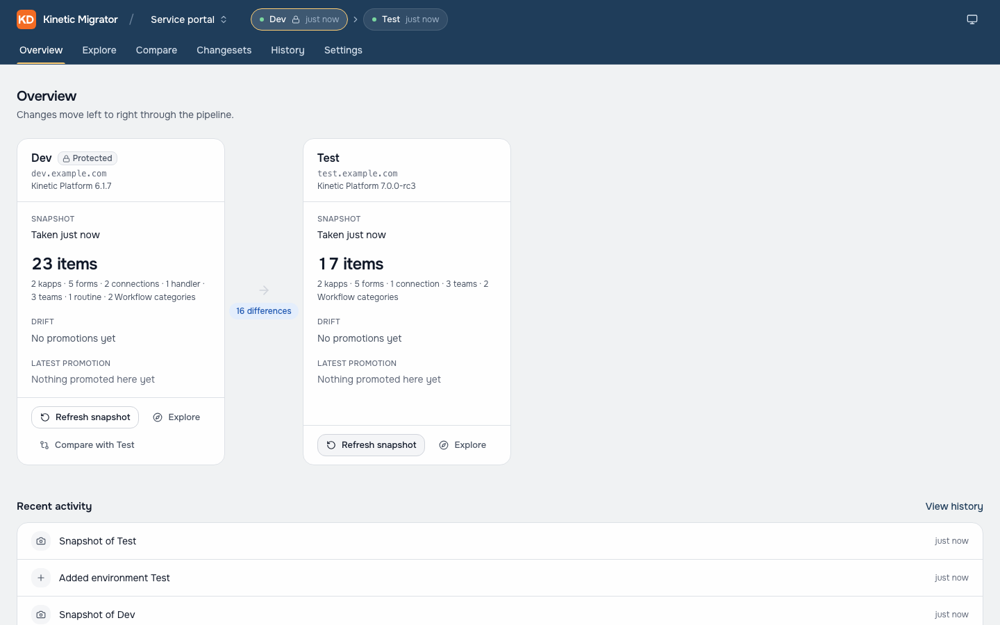

## 6. Explore what is in Dev

**Do this:** choose **Explore** on the Dev lane. Open **Kapps**, a kapp and
its **Forms**, then select a form.

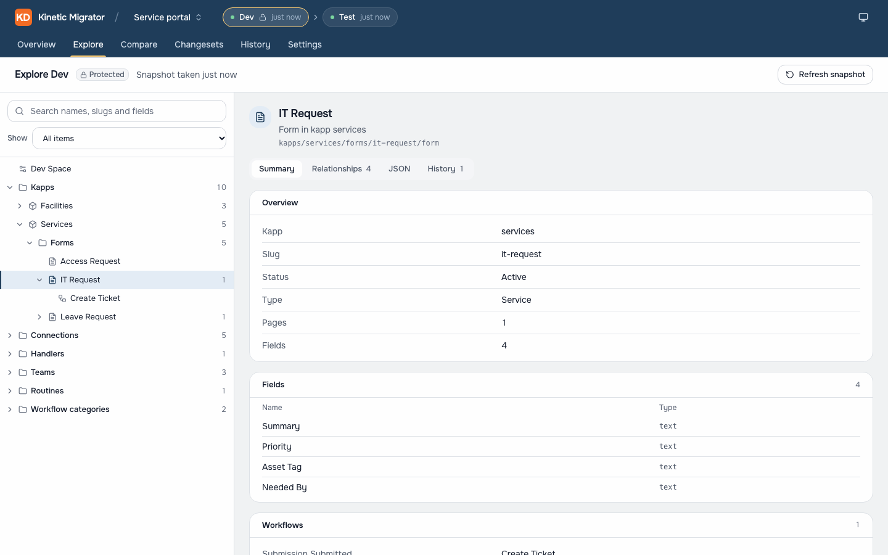

**Do this:** choose the **Relationships** tab.

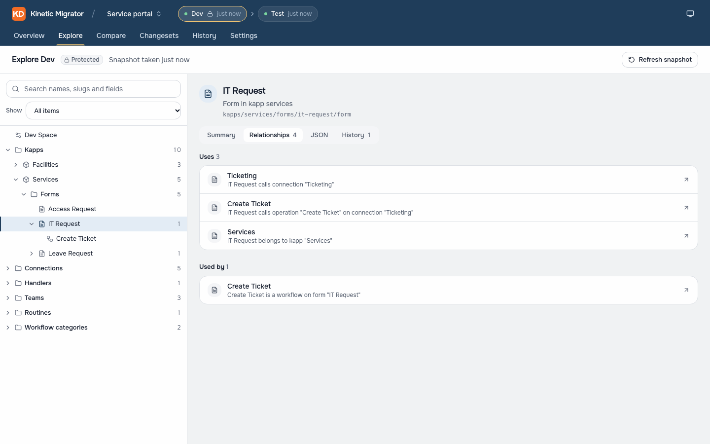

**Look for:** **Uses** (the connection, operation and kapp this form depends
on) and **Used by** (its workflow). These relationships are how Kinetic
Migrator suggests dependencies in the next steps. **JSON** shows the raw
definition and **History** shows each snapshot that changed it.

## 7. Compare Dev with Test

**Do this:** on **Overview**, choose **Compare with Test** on the Dev lane.
Choose **Expand all** (the double-arrow button above the tree) to open every
group.

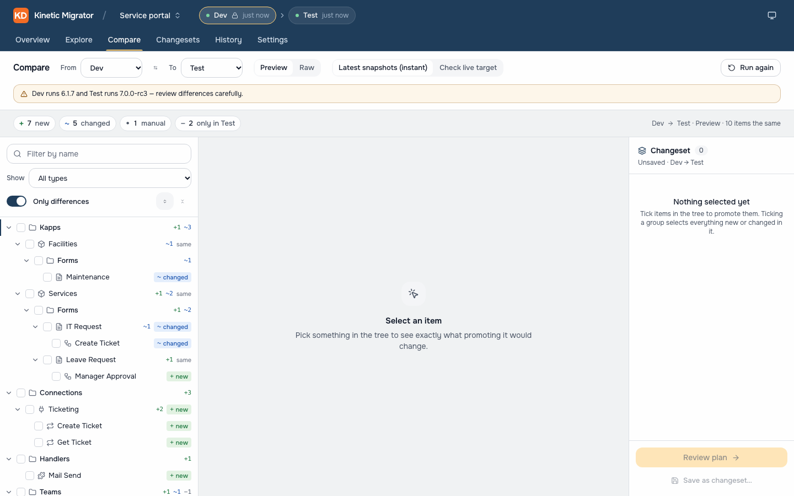

**Look for:**

- The counts across the top: **new** (only in Dev), **changed**, **manual**
  (promoted by hand, outside Kinetic Migrator) and **only in Test**.
- **Preview** shows what promoting would change in Test; **Raw** shows every
  difference. **Latest snapshots (instant)** compares the snapshots you
  took; **Check live target** reads Test again first.
- The filters on the left: **Filter by name**, **Show** (one type, such as
  Forms), and **Only differences**.
- A version warning when the spaces run different platform versions, as in
  this demo (6.1.7 and 7.0.0-rc3).

## 8. Look at an item's changes

**Do this:** select an item in the tree, here the **IT Request** form.

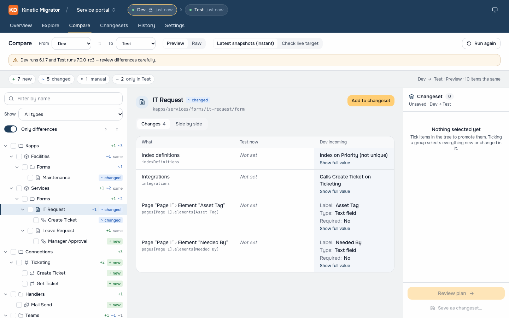

**Look for:** each change in plain words, with **Test now** beside **Dev
incoming**: here two new fields, an index and an integration. **Show full
value** expands one; **Side by side** shows both JSON documents.

## 9. Build a changeset

A changeset is the list of items you will promote.

**Do this:** tick the items to promote in the tree, here **IT Request** and
the **Mail Send** handler. Ticking a form also ticks its workflows.

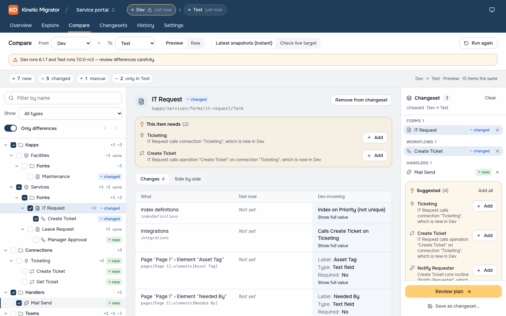

**Look for:** the **Suggested** list in the tray on the right, and **This item
needs** above the changes. Each suggestion says why, for example "IT Request
calls connection "Ticketing", which is new in Dev". Promoting the form
without it would leave the form calling a connection Test does not have.

**Do this:** choose **Add all** (or **Add** on each one you want).

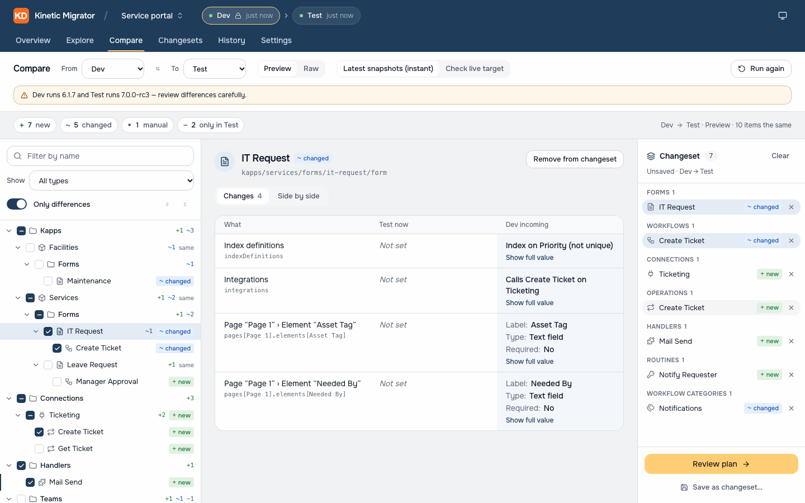

**Look for:** the tray grouped by type (Forms, Workflows, Connections,
Operations, Handlers, Routines, Workflow categories) with each item's status.
Choose **×** to take one out, or **Clear** to start again.

## 10. Remove something only Test has

Promoting only creates and updates. Nothing is deleted unless you choose it.

**Do this:** select an item marked **only in Test**, here the **Contractors**
team, and choose **Remove from Test**.

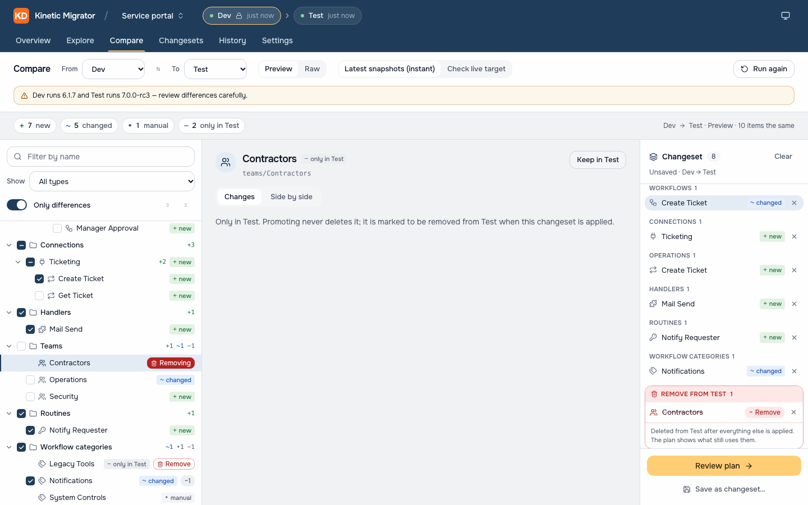

**Look for:** **Removing** next to it in the tree and a **Remove from Test**
group at the bottom of the tray. Choose **Keep in Test** to change your mind.

> **Why it's safe.** Removals are opt-in, one item at a time, and run after
> everything else. The plan warns about anything that still uses an item
> you remove, and about what a restore cannot bring back (for a team, its
> memberships).

## 11. Save the changeset

Saving lets you promote exactly the same set to the next environment later,
for example from Test to Prod.

**Do this:** choose **Save as changeset…** under the tray, enter a **Name**
and an optional **Description**, and choose **Save changeset**. Then choose
**Review plan**.

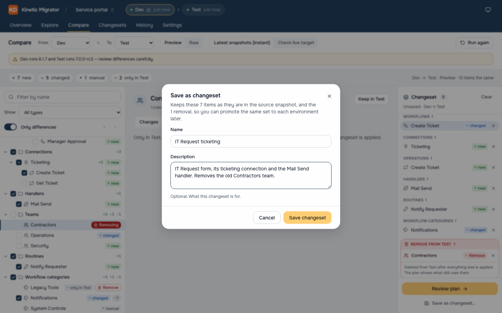

## 12. Review the plan

The plan lists every change that the apply will make to Test. Nothing has
been written yet.

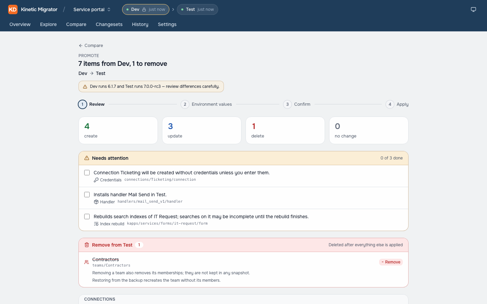

**Look for:** the counts (**create**, **update**, **delete**, **no change**),
any **Problems** with their fixes, the removal, and the item list below.

**Do this:** read each entry under **Needs attention** and tick it to confirm
you understand it. Then choose **Next: Environment values**.

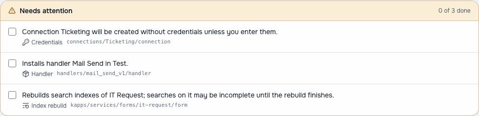

Typical entries: a connection that will be created without credentials, a
handler that will be installed, or search indexes that will be rebuilt (KQL
searches on that form may be incomplete until the rebuild finishes).

## 13. Environment values and secrets

Some values must differ per environment, such as a mail server or a handler
password. They are never copied from Dev.

**Do this:** for each value, keep what Test has or type the value for Test
(here the Mail Send **Server**, `smtp.test.example.com`). Under **Secrets
needed**, enter any password or key Test should get, or leave it empty to
keep what Test has. Tick **Remember in keychain** to keep them for next time.
Choose **Next: Confirm**.

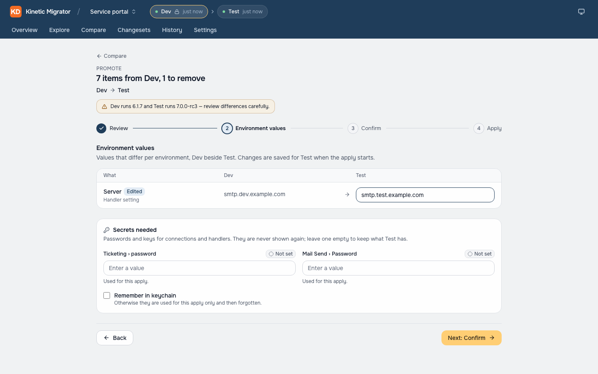

> **Why it's safe.** Secrets are write-only: they go from this form to Test
> and, if you choose, to your keychain. They are never exported, committed,
> logged or shown again. Existing connections in Test are never written, so
> their stored credentials are never touched.

## 14. Confirm

**Do this:** check the summary, then type the target's name, `test`, in
**Type test to confirm**, and choose **Apply to Test**.

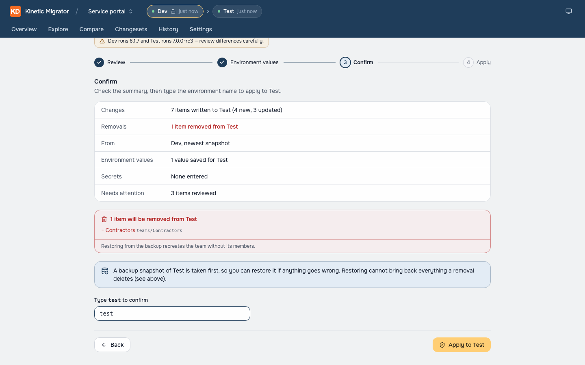

> **Why it's safe.** You confirm every apply by typing the target's name, so
> you cannot apply to the wrong environment by a stray click. A **backup
> snapshot** of Test is taken before anything is written, and you can restore
> from it. **Drift protection:** an item that was changed in Test by hand
> since it was last promoted is not overwritten unless you choose
> **Overwrite** for it.

## 15. Apply and watch it run

**Look for:** the live checklist. The **Backup of Test** comes first, then
each change in dependency order (connections before the forms that call
them), each with **Done** or an error. In demo mode it finishes at once.

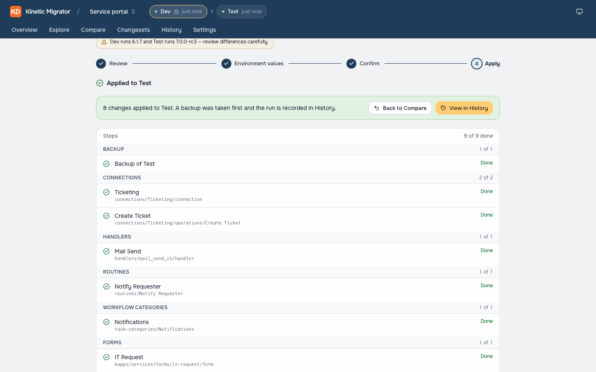

If a run is partly applied, fails or is cancelled, this screen offers
**Resume**, **View backup** and **Restore…**. When it is done, choose **View in History**.

## 16. Check History

History records every snapshot, changeset, backup, promotion and restore in
plain words.

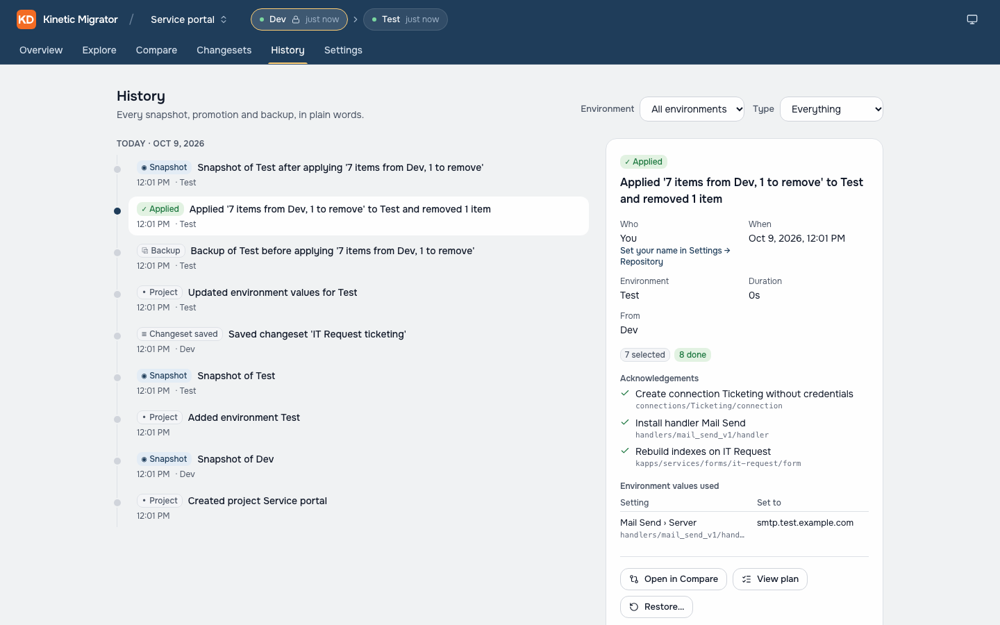

**Look for:** in the timeline, **Backup of Test before applying…**, then
**Applied … to Test**, then a fresh **Snapshot of Test after applying…**.
Select an event to see who ran it, what was acknowledged and which
environment values were used. **Open in Compare**, **View plan** and
**Restore…** are there too.

## 17. Preview a restore

You will not need this today, but it is good to know where it is.

**Do this:** select **Backup of Test before applying…** in History and choose
**Restore…**.

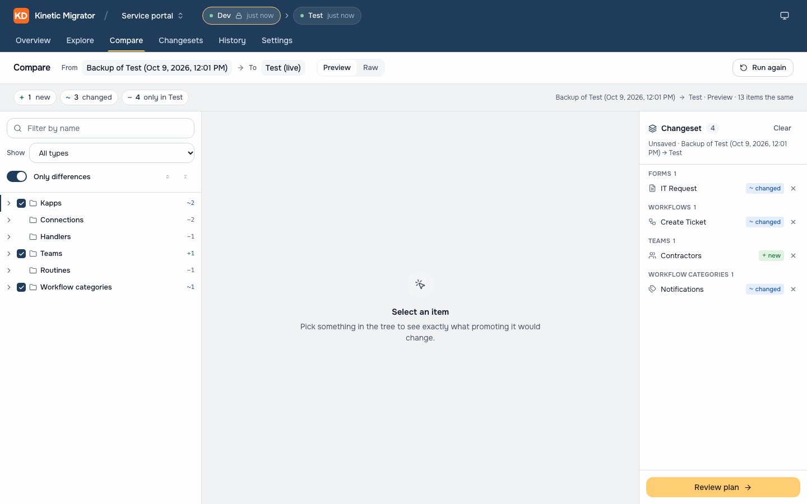

**Look for:** Compare opens from the backup to **Test (live)**, with the
changes that would put Test back already in the tray. Nothing happens until
you go through **Review plan** and confirm, exactly as for a promotion. You
can leave this screen without changing anything.

## 18. Saved changesets

**Do this:** open **Changesets**.

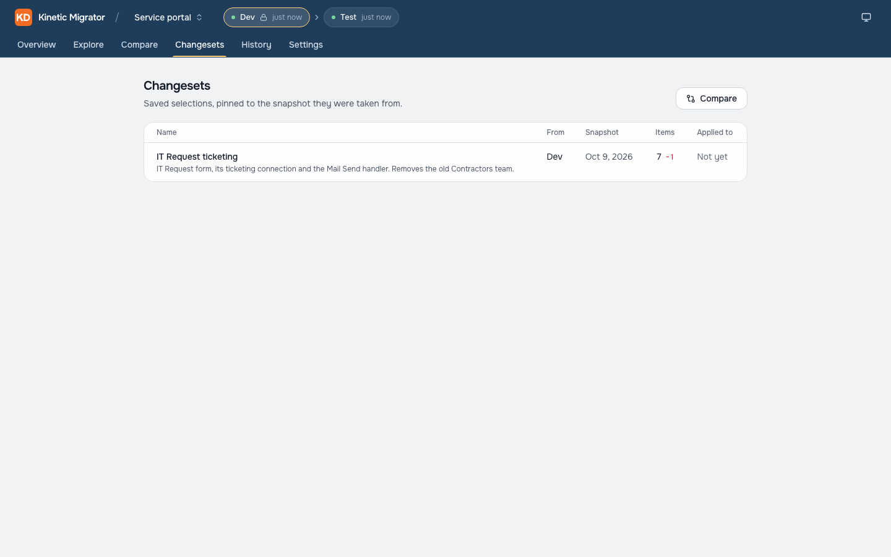

**Look for:** your saved changeset, the Dev snapshot it is pinned to, its
items and removals, and where it has been applied. Open it to **Plan
against** another environment (for example Prod) or compare it again.

## 19. Settings worth knowing

**Settings → Data & values** decides what stays different in each
environment.

**Space settings kept per environment.** Ticked space settings are never
changed by a promotion; each environment keeps its own value. The usual ones
(display, trusted domains, allowed IPs) are ticked from the start; the ones
that describe where a space lives are always kept.

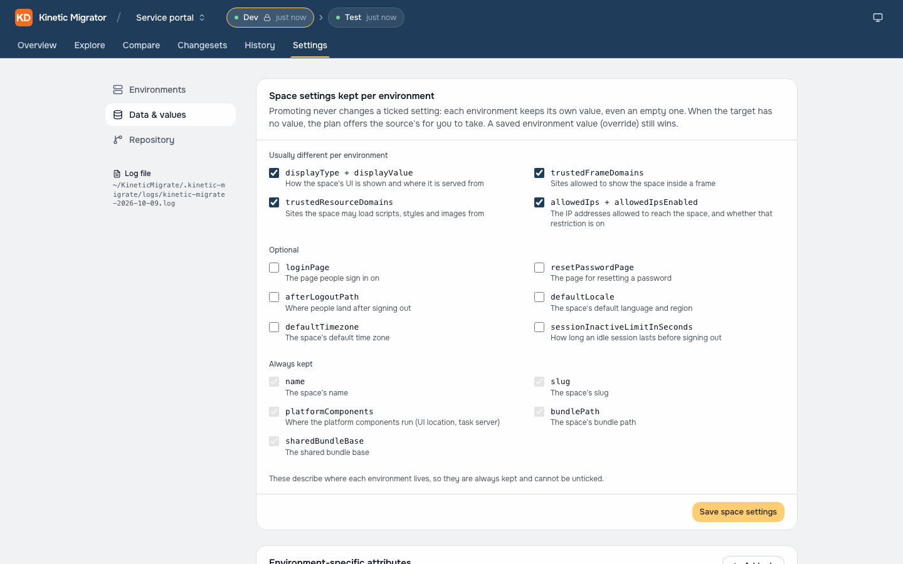

**Environment-specific attributes.** Add a rule for each attribute whose
value differs per environment, such as a server address, at the level it
lives on (Space, Kapp, Form, Category or Team). Choose **Save attributes**.

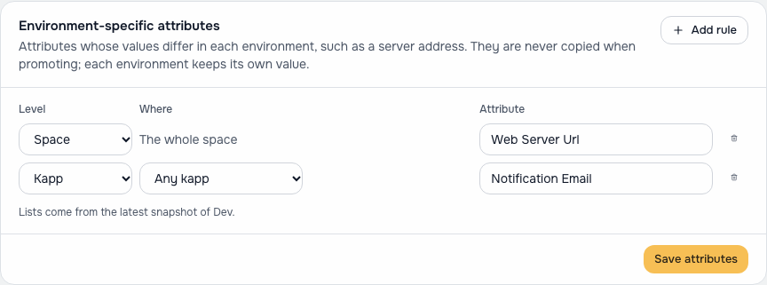

**Reference data.** Forms whose records travel with the configuration, such
as lookup lists. Choose the kapp and form, which records (all, or by
condition), and the fields that match a record across environments. Choose
**Save reference data**.

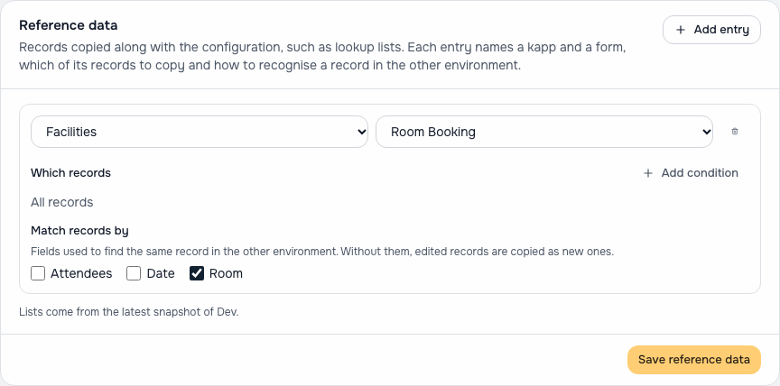

**Settings → Repository** holds the **Author** name History uses and an
optional **Remote repository**: push the project's history to your git
server so colleagues can see it. Credentials never go with it.

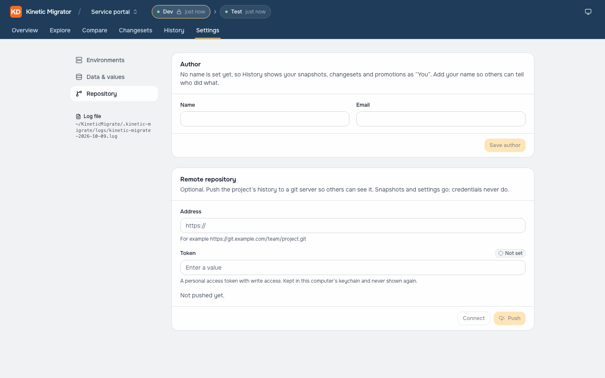

## 20. Dark mode

The **Theme** menu at the top right switches between System, Light and Dark.

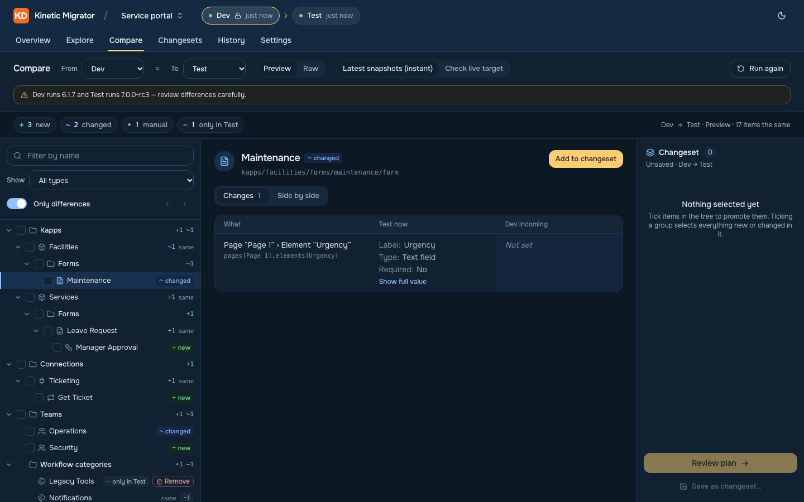

## Next steps

- Promote the same saved changeset from Test to Prod: add Prod in
  **Settings → Environments**, snapshot it, and choose **Plan against** on
  the changeset.
- Read the [User guide](USER-GUIDE.md) for every screen and option, and
  [Concepts](CONCEPTS.md) for snapshots, changesets, drift and environment
  values.
- Stuck? See [Troubleshooting](TROUBLESHOOTING.md).

To regenerate these screenshots after a UI change, run
`npm run docs:screenshots` (see [Development](DEVELOPMENT.md#tests)).
